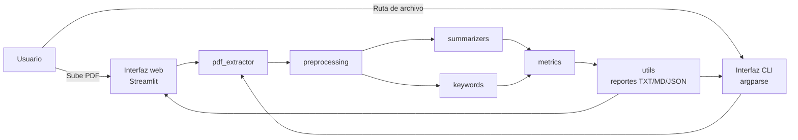
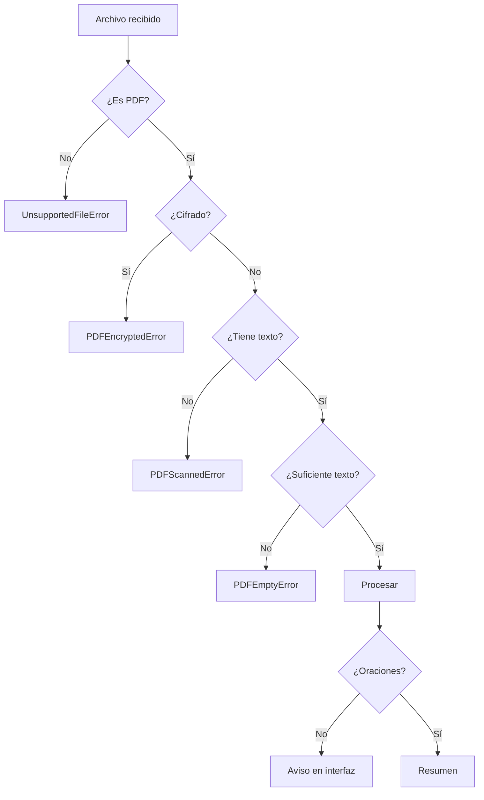

# Diseño de la solución

## 1. Arquitectura general

El proyecto sigue una arquitectura por capas: una interfaz (web o consola), un
núcleo de PLN independiente y una capa de recursos. Esto permite reutilizar los
algoritmos desde distintos clientes y probarlos sin levantar la interfaz.



### Capas

| Capa | Archivos | Responsabilidad |
| --- | --- | --- |
| Presentación web | `app.py`, `.streamlit/config.toml` | Carga, configuración, visualización y descargas. |
| Presentación consola | `cli.py` | Automatización y uso desde terminal. |
| Dominio / PLN | `src/preprocessing.py`, `src/summarizers.py`, `src/keywords.py`, `src/metrics.py` | Algoritmos y cálculos. |
| Infraestructura | `src/pdf_extractor.py`, `src/errors.py`, `src/utils.py` | Lectura de PDF, errores y exportación. |
| Recursos | `resources/` | Stopwords, PDF y texto de ejemplo. |
| Pruebas | `tests/` | Validación del núcleo. |

La interfaz no implementa algoritmos: solo orquesta llamadas al núcleo. Esto
facilita cambiar de Streamlit a otra tecnología sin reescribir la lógica.

---

## 2. Flujo de información

### 2.1. Flujo principal

```text
1. El usuario sube un PDF.
2. Se valida el tamaño y la cabecera %PDF.
3. pdf_extractor lee las páginas con pypdf.
4. Se limpia el texto: Unicode, guiones, URLs, números de página y encabezados.
5. Se detecta el idioma (español / inglés).
6. preprocessing segmenta, tokeniza, elimina stopwords y aplica stemming.
7. summarizers construye vectores TF-IDF y la matriz de similitud.
8. Se calcula el ranking (TF-IDF o TextRank).
9. MMR selecciona las oraciones finales.
10. Se reordena el resumen según el documento original.
11. keywords y metrics calculan palabras clave y estadísticas.
12. utils genera reportes y la interfaz los muestra/descarga.
```

### 2.2. Estados de la interfaz

| Estado | Comportamiento |
| --- | --- |
| Sin archivo | Pantalla de bienvenida con explicación y algoritmos. |
| Procesando | Spinner de Streamlit mientras se extrae y analiza. |
| Error controlado | Mensaje específico según el tipo de PDF. |
| Resultado | Métricas, pestañas de resumen, análisis, texto y ayuda. |
| Documento corto | Aviso de que el resumen puede ser casi igual al original. |
| Documento enorme | Aviso de muestreo uniforme por límite de oraciones. |

---

## 3. Algoritmos utilizados

### 3.1. Segmentación de oraciones

Se basa en reglas:

1. Normalizar Unicode y saltos de línea.
2. Unir palabras cortadas con guion.
3. Proteger abreviaturas, iniciales y decimales con un marcador temporal.
4. Dividir después de `.`, `!`, `?` o `…` cuando sigue una mayúscula, dígito o
   signo de apertura.
5. Restaurar los puntos protegidos.
6. Eliminar viñetas y numeración de listas.

### 3.2. TF-IDF + MMR

```text
Entrada: oraciones preprocesadas
Salida: k oraciones seleccionadas

1. Calcular df(t) para cada stem.
2. Calcular idf(t).
3. Para cada oración:
   a. contar términos;
   b. calcular TF aumentado;
   c. multiplicar por IDF;
   d. normalizar el vector L2.
4. Calcular el centroide del documento.
5. relevancia(i) = similitud coseno(oración_i, centroide).
6. Añadir un pequeño sesgo de posición (inicio y final).
7. Normalizar relevancias a [0, 1].
8. Seleccionar k oraciones con MMR.
9. Reordenar por posición original.
```

### 3.3. TextRank

```text
Entrada: oraciones preprocesadas
Salida: k oraciones seleccionadas

1. Construir vectores TF-IDF.
2. Construir un grafo no dirigido:
   arista(i, j) = similitud coseno(i, j) si es mayor que cero.
3. Inicializar PR(i) = 1/N.
4. Repetir hasta converger:
   PR(i) = (1-d)/N + d * suma de contribuciones de vecinos.
5. Normalizar los puntajes.
6. Seleccionar k oraciones con MMR (opcional).
7. Reordenar por posición original.
```

### 3.4. MMR

```text
seleccionadas = []
max_sim = [0] * N

mientras |seleccionadas| < k:
    elegir i que maximice:
        λ * relevancia[i] - (1-λ) * max_sim[i]
    agregar i a seleccionadas
    para cada j no seleccionada:
        max_sim[j] = max(max_sim[j], similitud(i, j))
```

### 3.5. Palabras clave

```text
1. Calcular df(t) y idf(t) sobre las oraciones.
2. Contar frecuencia global de cada stem.
3. score(t) = frecuencia(t) * idf(t).
4. Ordenar de mayor a menor.
5. Mostrar la forma superficial más frecuente de cada stem.
6. Normalizar los puntajes a [0, 1].
```

---

## 4. Estructuras de datos empleadas

| Estructura | Dónde se usa | Propósito |
| --- | --- | --- |
| `PDFDocument` | `src/pdf_extractor.py` | Texto, páginas, metadatos y advertencias. |
| `Sentence` | `src/preprocessing.py` | Oración con palabras, tokens, stems y formas superficiales. |
| `SummaryResult` | `src/summarizers.py` | Resumen, oraciones, selección, puntajes y configuración. |
| `Keyword` | `src/keywords.py` | Término, puntaje y frecuencia. |
| `TextStats` | `src/metrics.py` | Métricas del documento o del resumen. |
| `list[Sentence]` | Todo el núcleo | Secuencia ordenada de oraciones. |
| `tuple[str, ...]` | `Sentence` | Tokens y stems inmutables y alineados. |
| `Counter` | TF-IDF, keywords | Conteo de frecuencias y DF. |
| `dict[str, float]` | Vectores TF-IDF | Representación dispersa de cada oración. |
| `dict[int, float]` | Matriz de similitud | Fila dispersa del grafo de oraciones. |
| `set[int]` | MMR, Jaccard | Conjunto de seleccionadas y operaciones de conjuntos. |
| `frozenset[str]` | Stopwords | Búsqueda O(1) y caché. |
| `lru_cache` | Stopwords y stemmer | Evita recargar recursos. |

### 4.1. Matriz dispersa

Una matriz densa de `N × N` con `N = 2000` oraciones ocuparía 4 millones de
valores. En su lugar se usa un **índice invertido**: para cada término se guarda
la lista de oraciones que lo contienen. Solo se calculan los pares que comparten
al menos un término, y cada fila se almacena como un diccionario
`{índice: similitud}`.

Complejidad aproximada:

- TF-IDF: `O(total de tokens)`.
- Índice invertido: `O(total de tokens)`.
- Similitud: `O(Σ df(t)²)` en el peor caso, mucho menor que `O(N²)` en la práctica.
- PageRank: `O(iteraciones × aristas)`.
- MMR: `O(k × N)`.

Para documentos muy extensos se limita el análisis a 2000 oraciones mediante un
muestreo uniforme, y la interfaz lo advierte.

---

## 5. Diseño de interfaces

### 5.1. Interfaz web

La aplicación usa Streamlit con un diseño de una columna principal y una barra
lateral de configuración.

**Barra lateral**

- Algoritmo: TF-IDF + MMR o TextRank.
- Tamaño del resumen: 10 % a 50 %.
- Idioma: detección automática, español o inglés.
- Opciones avanzadas: MMR, λ, mínimo de palabras, palabras clave y viñetas.

**Zona principal**

1. Encabezado con propósito de la aplicación.
2. Cargador de PDF.
3. Pantalla de bienvenida si no hay archivo.
4. Ficha del documento: título, tamaño, páginas e idioma.
5. Métricas principales: palabras originales, palabras del resumen, compresión y
   ahorro de lectura.
6. Pestañas:
   - **Resumen:** texto, descargas y oraciones seleccionadas.
   - **Análisis:** palabras clave, puntajes, estadísticas, legibilidad y
     comparación de algoritmos.
   - **Texto extraído:** contenido completo y vista por páginas.
   - **Acerca de:** explicación, fórmulas, privacidad y limitaciones.

**Principios de diseño**

- Mensajes claros y en español.
- Errores con causa y acción sugerida.
- Controles con valores por defecto razonables.
- Descargas en formatos abiertos.
- Todo el procesamiento es local.
- Colores con contraste y jerarquía visual.

### 5.2. Interfaz de consola

La CLI usa `argparse` y permite:

- elegir método, proporción, idioma y MMR;
- mostrar palabras clave y estadísticas;
- exportar texto o JSON;
- integrarse en scripts y tuberías de Unix.

La salida principal va a `stdout` y los mensajes de estado a `stderr`, para no
contaminar la salida cuando se redirige a un archivo.

---

## 6. Manejo de errores



Las excepciones viven en `src/errors.py`. La interfaz captura
`PDFSummarizerError` y muestra el mensaje; cualquier error inesperado se muestra
con un mensaje amigable y un detalle técnico en un expander. La CLI devuelve
código de salida 2 ante errores.

---

## 7. Decisiones de diseño

| Decisión | Justificación |
| --- | --- |
| Streamlit | Permite una interfaz web completa con poco código y es fácil de ejecutar. |
| `pypdf` | Ligero, multiplataforma y sin binarios externos. |
| Implementar TF-IDF/PageRank/MMR | Hace visible la teoría y evita dependencias innecesarias. |
| Stopwords en archivos de texto | Recursos editables, auditables y sin descargas. |
| NLTK solo para Snowball | No requiere corpus ni conexión a internet. |
| Resumen extractivo | Explicable, reproducible y sin coste de API. |
| Matriz dispersa | Mantiene el rendimiento en documentos medianos. |
| Reordenar por posición | Mejora la coherencia y la lectura del resumen. |
| Descargas TXT/MD/JSON | Facilitan la entrega y la integración con otros sistemas. |
